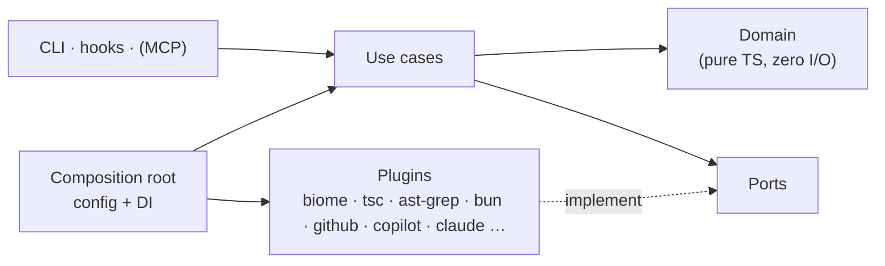

<div align="center">


<br>


-a78bfa?style=flat-square)


### Your agents are fast. MetatorAI makes them *right*.

**Survey the codebase. Lay out the rules. Prove every claim. Then ship.**

</div>

---

In the Roman legion, the **metator** marched ahead of the army. He chose the ground,
measured it and staked out the camp (streets, walls, a place for every unit), so that
when the legion arrived, no one had to guess.

**MetatorAI does that for AI agents working on your code.** Before a single line changes,
it maps the terrain: dependency graph, module boundaries, existing patterns, the
decisions in your ADRs. Then it marks out the lines every change must follow, and
puts gates on them that no agent can skip.

> **No guessing. No reinventing. No unproven review comments.**

---

## The Metator loop

<div align="center">

</div>

| | Stage | What really happens |
|---|---|---|
| 🧭 | **Survey** | Parallel subagents read *measured facts*: dependency graph, affected modules, pattern index, the rule pack for exactly the files in scope. |
| 📐 | **Plan** | Every step names a file, a skill, the tests to write first, and **an exemplar from your own codebase (`file:line`)**. A new abstraction requires an ADR. |
| 🚧 | **Gate** | `plan lint` (deterministic) → plan critic (different model) → **you**. |
| 🔨 | **Build** | Tests go **RED → GREEN**. Hooks block any edit outside the plan's scope and lint every file the moment it changes. |
| 🔍 | **Verify** | Review lenses run in parallel. An independent verifier tries to *refute* every finding. Blocking issues loop back to the plan, but only a bounded number of times. |
| 🚀 | **Ship** | The PR is drafted, but nothing is pushed until a human says go. |

Every stage leaves an **artifact with a schema**. A stage is done when the artifact exists
and validates, not when the model says so.

---

## Review that has to prove itself

<div align="center">

</div>

AI code review usually fails in two ways: comments that are confidently wrong, and
silence on the bug that matters. MetatorAI attacks both:

- **Sharded by module** so every lens sees a diff it can actually reason about, plus that module's card and rules.
- **Parallel lenses** (logic, contracts, tests, security, behavioral equivalence) give recall.
- **Every finding must carry evidence:** an exact quote, a triggering input, a reachability path from a real caller. No evidence means it can't block.
- **An independent verifier**, on a different model and with a clean context, tries to *refute* each one. A failing test beats an argument.
- **Measured, not vibed:** precision and recall are tracked against a golden set of real PRs. A prompt change that makes review worse turns CI red.

---

## Why teams pick MetatorAI

<table>
<tr>
<td width="50%" valign="top">

### 🧱 Patterns, not reinvention
Agents start from *how your codebase already solves it*. A structural pattern index
(ast-grep) ranks real exemplars, so new code looks like your best code, not like the internet's average.

</td>
<td width="50%" valign="top">

### 🔒 Gates you can't talk your way past
Workflows are declarative **state machines**. Scripts validate every transition,
hooks enforce scope and approvals, and the `Stop` hook won't let a run end half-done.

</td>
</tr>
<tr>
<td valign="top">

### 🧠 Memory that stays true
One canon for rules and decisions, a generated code index, per-run working memory,
and learned lessons. **Every remembered fact cites `file:line` and is re-validated**
before it is used.

</td>
<td valign="top">

### ♻️ Refactors that keep behavior
Characterization tests first, then public-API diffs and dependency-graph diffs as gates.
"Nothing changed" becomes something you can **prove**.

</td>
</tr>
<tr>
<td valign="top">

### 🔌 Speaks capabilities, not tools
Workflows ask for `lint`, `test`, `typecheck`, `rules`, `graph`, never for a specific
binary. Swap Biome for ESLint or Jest for Vitest in config. Nothing else changes.

</td>
<td valign="top">

### 🎛️ One canon, every host
Agents, skills, rules and hooks are written once in a host-neutral format and **generated**
for GitHub Copilot and Claude Code. Interactive in your editor, headless in CI.

</td>
</tr>
</table>

---

## Drops into any repo

```bash
npm i -D metator-ai          # or: pnpm add -D · yarn add -D · bun add -d
npx metator init             # survey → propose config → you approve → generate agents
npx metator doctor           # proves every capability actually works in *this* repo
```

`metator init` detects your package manager, workspaces, scripts, linters, test runners,
CI and code host. It measures your import directions and naming conventions, and an agent
proposes a config backed by those numbers. You approve it and you're done.

```ts
// metator.config.ts (proposed by `metator init`, approved by you)
import { defineConfig } from "metator-ai";

export default defineConfig({
  plugins: ["node", "typescript", "biome", "ast-grep", "bun-test", "github", "host-copilot", "host-claude"],
  capabilities: {
    lint:      { files: { preset: "biome" }, full: { script: "lint" } },
    typecheck: { preset: "tsc", scope: "package" },
    rules:     [{ preset: "ast-grep" }],
    test:      { preset: "bun-test" },
  },
  gates: {
    quick: ["format", "lint.files", "rules"],
    full:  ["lint.full", "typecheck", "rules", "test:affected", "graph:diff", "api:diff"],
  },
  naming: { agentPrefix: "mt" },   // → mt-orchestrator, mt-pr-review, …
});
```

Then, in Copilot Chat or Claude Code:

```text
/mt-feature  AB#1234            → full loop, you approve the plan and the push
/mt-review   <PR url>           → review with proof
/mt-refactor packages/billing   → behavior-preserving refactor
/mt-docs                        → turn your docs and ADRs into enforceable rules
/mt-resume                      → pick up any run exactly where it stopped
```

### Planned support

| Layer | |
|---|---|
| **AI hosts** | GitHub Copilot (VS Code, CLI, coding agent) · Claude Code |
| **Package managers** | npm · yarn · pnpm · bun |
| **Monorepo tools** | workspaces · Nx · Turborepo |
| **Quality** | Biome · ESLint · Prettier · tsc · ast-grep |
| **Tests & coverage** | bun test · Vitest · Jest · Playwright, via **JUnit** & **LCOV** |
| **Diagnostics** | native JSON or **SARIF**, so one parser covers dozens of tools |
| **Code hosts & trackers** | GitHub · Azure DevOps · GitLab · Jira |
| **CI** | GitHub Actions · Azure Pipelines · GitLab CI, including self-hosted runners |

---

## Under the hood



Clean architecture with ports and adapters, and a tiny typed DI container (lazy, so hooks start in milliseconds).
New tools arrive as **presets** (a command plus a standard-format parser), so adding one is a few lines of declaration
rather than new code.

---

## Principles

> **LLMs decide. Scripts measure. Hooks enforce. Humans approve.**

1. **Evidence or it didn't happen:** no `file:line`, no claim.
2. **Paths, not paste:** agents hand each other artifact paths, never walls of text.
3. **Bounded loops:** every retry has a limit and an escalation.
4. **Least privilege:** reviewers read, implementers edit only what the plan allows, nobody pushes alone.
5. **Data is not instructions:** PR text, issues and docs are inputs, never commands.

---

## Roadmap

- [ ] **Core**: domain, ports, DI container, config, run state machine
- [ ] **Survey**: graph, affected, symbols, API surface, pattern index
- [ ] **Bootstrap**: `metator init`, script classifier, `doctor`
- [ ] **Review**: Find → Verify → Judge, finding schema, golden-set evals
- [ ] **Build loop**: orchestrator, plan lint, scope guards, TDD, refactor contract
- [ ] **Hosts**: Copilot and Claude Code generators, hook codecs, headless `drive`
- [ ] **CI**: generators for GitHub Actions, Azure Pipelines, GitLab CI · self-hosted runner image

---

<div align="center">

**MetatorAI**: because the camp is laid out *before* the legion arrives.

</div>
