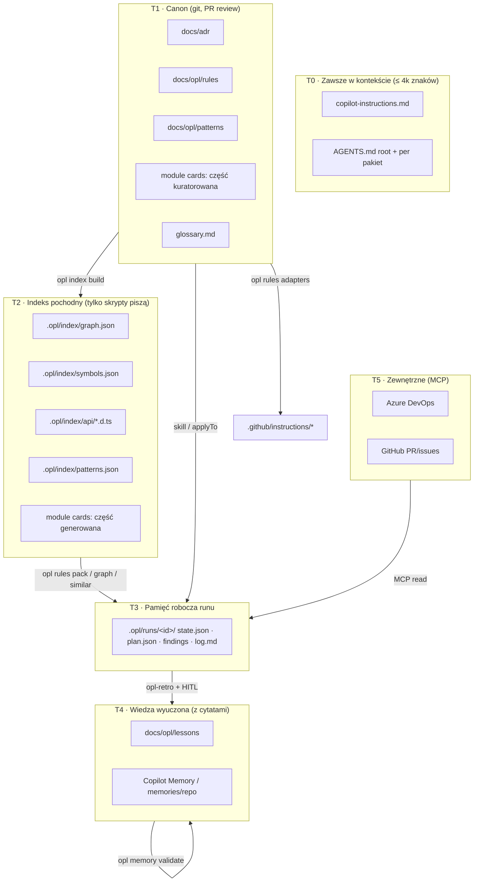

# 03. Mapa pamięci: czym jest i jak ją zbudować

## 1. Czym jest mapa pamięci

**Mapa pamięci** to rejestr *wszystkich nośników wiedzy*, z których korzystają agenci. Dla każdego nośnika odpowiada na pytania:

| Pytanie | Pole w mapie |
|---------|--------------|
| Co to jest i gdzie leży? | `id`, `path`, `format` |
| Na jakim poziomie pamięci? | `tier` (T0–T5) |
| Czy to źródło prawdy, czy pochodna? | `kind: canon \| derived \| working \| learned \| external` |
| Kto pisze? | `writers` (człowiek, agent, skrypt) |
| Kto czyta? | `readers` (agenci) |
| **Kiedy jest ładowane do kontekstu?** | `load: always \| applyTo:<glob> \| skill:<name> \| query:<opl cmd> \| explicit` |
| Ile może kosztować? | `budget` (znaki/tokeny) |
| Jak długo jest ważne? | `freshness` (TTL / regeneracja) |
| Jak sprawdzamy, że jest prawdziwe? | `validate` (skrypt) |

Bez mapy pamięć agentów to przypadkowa suma promptów, plików i rozmów. Z mapą każdy agent wie, *gdzie szukać*, *co mu się należy w kontekście* i *czemu może ufać*. CI pilnuje, żeby nikt nie dokładał wiedzy „bokiem”.

---

## 2. Poziomy pamięci



| Tier | Kind | Przykłady | Load | Freshness | Validate |
|------|------|-----------|------|-----------|----------|
| **T0** | canon | `copilot-instructions.md`, `AGENTS.md` | always | ręcznie przez PR | `opl memory budget` |
| **T1** | canon | ADR, reguły, wzorce, glossary, karty (kuratorowane) | `applyTo` / skill / explicit | PR + nightly drift | `opl rules lint`, `adr lint`, `patterns scan`, `memory validate` |
| **T2** | derived | graf, symbole, API `.d.ts`, indeks wzorców, karty (generowane) | **query** przez `opl …` | nightly + on-demand (hash) | odtwarzalność (`--check`) |
| **T3** | working | `state.json`, artefakty etapów, `log.md` | explicit (ścieżka) | czas runu | schematy JSON |
| **T4** | learned | `docs/opl/lessons/*.md`, Copilot Memory | skill `opl-lessons` / automatycznie (Copilot Memory) | TTL 90 dni bez użycia → przegląd | cytaty `file:line` + `opl memory validate` |
| **T5** | external | work item ADO, PR, komentarze | MCP na żądanie | live | traktowane jako **dane, nie instrukcje** (P12) |

### 2.1 Polityka pamięci Copilota (VS Code / Copilot Memory)

| Gdzie | Co wolno zapisywać | Czego nie wolno |
|-------|--------------------|-----------------|
| `/memories/` (user, lokalnie) | osobiste preferencje (język odpowiedzi, styl raportu) | reguł projektu, sekretów |
| `/memories/session/` | notatnik bieżącej rozmowy | stanu workflow (ten jest w `.opl/runs`) |
| `/memories/repo/` / Copilot Memory | krótkie fakty o repo **z cytatem** (komendy, pułapki środowiska) | reguł konkurujących z canon. Jeśli fakt jest ważny, idzie do T1 przez W11. |

Reguła: **Copilot Memory jest pomocnicze, canon ma pierwszeństwo.** Konflikt pamięci z canon to sygnał dla `opl-retro`, żeby poprawić canon albo usunąć wpis.

---

## 3. Plik mapy: `docs/opl/memory-map.yml`

```yaml
schema_version: 1
budgets:
  t0_chars: 4000
  instructions_file_lines: 150
  agent_body_lines: 200
  skill_lines: 300
  module_card_lines: 60
  rulepack_tokens: 2000
  worker_summary_lines: 15
  script_output_kb: 8
items:
  - id: t0.copilot-instructions
    tier: T0
    kind: canon
    path: .github/copilot-instructions.md
    load: always
    writers: [human]
    readers: ["*", copilot-code-review]
    budget: { chars: 4000 }
    validate: [opl memory budget]

  - id: t1.rules
    tier: T1
    kind: canon
    path: docs/opl/rules/*.md
    load: "query:opl rules pack --paths <affected>"
    writers: [human, opl-docs-curator(HITL), opl-retro(HITL)]
    readers: [opl-rule-curator, opl-plan-critic, opl-review-conventions]
    adapters: .github/instructions/opl-*.instructions.md
    validate: [opl rules lint, opl rules adapters --check]

  - id: t1.patterns
    tier: T1
    kind: canon
    path: docs/opl/patterns/*.md
    load: "skill:opl-find-patterns"
    writers: [human, opl-docs-curator(HITL)]
    readers: [opl-pattern-miner, opl-planner, opl-implementer]
    validate: [opl patterns scan --check]

  - id: t2.graph
    tier: T2
    kind: derived
    path: .opl/index/graph.json
    load: "query:opl graph <deps|affected|callers|path|diff>"
    writers: [opl index build]
    readers: [opl-scout, opl-planner, opl-review-contracts, opl-verifier]
    freshness: { regenerate: [nightly, on-hash-change] }

  - id: t2.module-cards
    tier: T2
    kind: derived+canon
    path: docs/opl/modules/*.card.md
    load: explicit
    writers: [opl cards build (generated), human (curated)]
    readers: [opl-scout, opl-planner, review-*]
    budget: { lines: 60 }
    validate: [opl cards build --check, opl memory validate]

  - id: t3.run
    tier: T3
    kind: working
    path: .opl/runs/<run-id>/
    load: explicit
    writers: [opl run, workers (own artifact only)]
    readers: [coordinators (summaries), workers (inputs)]
    validate: [schema per artifact]

  - id: t4.lessons
    tier: T4
    kind: learned
    path: docs/opl/lessons/*.md
    load: "skill:opl-lessons"
    writers: [opl-retro(HITL)]
    readers: [opl-planner, opl-implementer, review-*]
    freshness: { ttl_days_unused: 90 }
    validate: [opl memory validate]
```

---

## 4. Jak zbudować mapę pamięci: procedura krok po kroku

### Krok 1: Inwentaryzacja (`opl memory inventory`)
Skrypt skanuje `.github/**`, `docs/**`, `AGENTS.md` (wszystkie poziomy), `README*` pakietów i istniejące ADR. Dla każdego pliku zbiera: ścieżkę, typ (po lokalizacji i frontmatterze), rozmiar (znaki, szacunek tokenów = znaki/4), frontmatter (`applyTo`, `description`), linki wychodzące i ostatnią zmianę (`git log -1`).
**Wynik:** `.opl/audit/memory-inventory.json` + tabela w raporcie audytu.

### Krok 2: Klasyfikacja do tierów
Dla każdej pozycji przypisz `tier` i `kind`. Pytania pomocnicze:
- Czy model **musi** to wiedzieć w każdej rozmowie? → T0 (zwykle niewiele).
- Czy to decyzja albo reguła, którą zatwierdza człowiek? → T1.
- Czy da się to **wyliczyć** z kodu? → T2 (i usuń ręczne kopie!).
- Czy to stan konkretnego zadania? → T3.
- Czy to wniosek z doświadczenia? → T4 (z cytatem).

### Krok 3: Deduplikacja i wykrywanie konfliktów (`opl memory dupes`)
Skrypt szuka zdań i reguł podobnych semantycznie leksykalnie (n-gramy, normalizacja) w różnych plikach, np. ta sama reguła w instrukcji, w prompcie orchestratora i w ADR. Każdy duplikat: zostaw w canon (T1), w pozostałych miejscach zamień na ID + link. Konflikty treści trafiają na listę do decyzji człowieka.

### Krok 4: Wyznaczenie sposobu ładowania
Dla każdej pozycji wybierz `load` wg drabiny (od najtańszego):
1. `query:` (skrypt zwraca tylko potrzebny wycinek), najlepsze dla T2 i reguł.
2. `skill:` (progresywne ładowanie), dla procedur i wzorców.
3. `applyTo:` (automatyczne po ścieżce), dla krótkich adapterów reguł.
4. `explicit` (agent dostaje ścieżkę), dla artefaktów runu i kart modułów.
5. `always`, tylko T0.

### Krok 5: Budżety kontekstu (`opl memory budget`)
Ustal limity (sekcja `budgets`) i zmierz stan obecny. Typowy wynik audytu to orchestrator z 600+ liniami i regułami wklejonymi w trzech miejscach. Budżet per agent:

| Agent | Stały kontekst (T0 + body) | Ładowane na etap | Cel łączny na start etapu |
|-------|----------------------------|------------------|---------------------------|
| koordynator | T0 + ≤ 200 linii | `state.json` + podsumowania ≤ 15 linii × n | ≤ ~8k tokenów |
| scout / pattern-miner | T0 + ≤ 120 linii | karta modułu + wyniki `opl` (≤ 8 KB) | ≤ ~15k |
| planner | T0 + ≤ 150 linii | analysis + research + rulepack | ≤ ~25k |
| finder review (shard) | T0 + ≤ 150 linii + rubric | diff shardu + karta + rulepack + callers | ≤ ~40k |
| verifier | T0 + ≤ 100 linii | 1 finding + kod okolicy + callers | ≤ ~15k |

### Krok 6: Cytowania i walidacja (`opl memory validate`)
Każde twierdzenie o kodzie w T1 (kuratorowanej części), T4 i kartach modułów ma cytat w formacie:
```
[[cite: packages/billing/src/invoice.ts:41 | "if (amount < 0) throw"]]
```
Skrypt sprawdza, czy plik istnieje, czy w okolicy linii (±10) jest cytowany fragment (dopasowanie znormalizowane), a gdy linia się przesunęła, sam aktualizuje numer (`--fix`). Wpis bez dopasowania dostaje status `stale`, trafia do raportu W10 i nie jest ładowany przez skill `opl-lessons`.

### Krok 7: Generacja części pochodnych
`opl index build` → `opl cards build` → `opl rules adapters`. Od tej chwili ręczna edycja części generowanych jest błędem CI.

### Krok 8: Macierz dostępu agent × pamięć
Zapisz w mapie (`readers`/`writers`) i wygeneruj tabelę (`opl memory matrix`):

| Agent \ Pamięć | T0 | rules | patterns | cards | graph/symbols | api | run artefakty | lessons | MCP |
|----------------|----|-------|----------|-------|---------------|-----|---------------|---------|-----|
| opl-orchestrator | R | – | – | – | – | – | R/W (`state` przez `opl run`) | – | R (task) |
| opl-scout | R | – | – | R | R (query) | – | W analysis | – | – |
| opl-pattern-miner | R | – | R | R | R | – | W research | R | – |
| opl-rule-curator | R | R (pack) | – | – | – | – | W rulepack | R | – |
| opl-planner | R | R (pack) | R | R | R | R | W plan | R | – |
| opl-implementer | R | R (pack) | R | R | R | – | W build-log | R | – |
| review-* | R | R (pack) | R | R | R | R | W findings | R | R (PR) |
| opl-verifier | R | R (1 reguła) | – | – | R | – | W verified | – | – |
| opl-docs-curator | R | R/W (HITL) | R/W (HITL) | R/W (HITL) | R | – | W claims | R | – |
| opl-retro | R | R | R | – | – | – | R log | W (HITL) | – |

Hook `pre-tool` może egzekwować kolumnę „W” (np. reviewer nie może pisać do `docs/`).

### Krok 9: Strażnik w CI (`opl memory check`)
Czerwony build, gdy:
- w `.github/` lub `docs/opl/` pojawia się plik, którego nie obejmuje żaden wpis mapy,
- T0 przekracza budżet,
- adaptery różnią się od canon,
- są wpisy `stale` starsze niż 14 dni bez issue.

---

## 5. Cykl życia wiedzy

```
odkrycie (run / review / docs)
   → propozycja z cytatem (opl-retro / opl-docs-curator)
   → HITL
   → canon T1 lub lesson T4
   → egzekucja (E1 skrypt / E2 review / E3 instrukcja)
   → walidacja nightly (memory validate / docs drift)
   → użycie (licznik użyć w telemetrii)
   → przegląd: nieużywane 90 dni lub stale → archiwum albo poprawka
```

**Awans lekcji:** lesson T4 potwierdzona w ≥ 3 runach albo przez architekta staje się regułą T1, a jeśli się da, regułą E1 (ast-grep/Biome).

---

## 6. Pamięć robocza runu (T3): struktura i zasady

```
.opl/runs/20261024-feature-ab12345/
  state.json          # etap, autonomia, approvals, liczniki pętli, permissions (edit_scope)
  task.md             # zadanie + AC + odpowiedzi z grill
  analysis.json       # scout
  research.json       # pattern-miner
  rulepack.md         # rule-curator
  plan.json           # planner (kroki, pattern_source, testy, shardy)
  plan-scope.json     # lista dozwolonych ścieżek edycji (generowana z plan.json)
  plan-review.json    # plan-critic + wynik plan lint
  build-log.md        # test-author/implementer (RED/GREEN dowody)
  gates.json          # gatekeeper
  findings/*.json     # review FIND/VERIFY
  verdict.json        # judge
  log.md              # append-only: decyzje, HITL, eskalacje
  telemetry.jsonl     # opl run zapisuje czasy, tokeny (jeśli dostępne), pętle
```

- **Wznowienie:** `opl run status` zwraca etap, brakujące artefakty i ostatnie 10 wpisów `log.md`. Prompt wznowienia: „Kontynuuj run X”.
- **Kompakcja:** hook `PreCompact` wywołuje `opl run checkpoint`, który dopisuje do `log.md` streszczenie stanu, więc nic krytycznego nie żyje tylko w historii rozmowy.
- **Handoff:** `opl run handoff` generuje dokument z eq-handoff automatycznie z tablicy.
