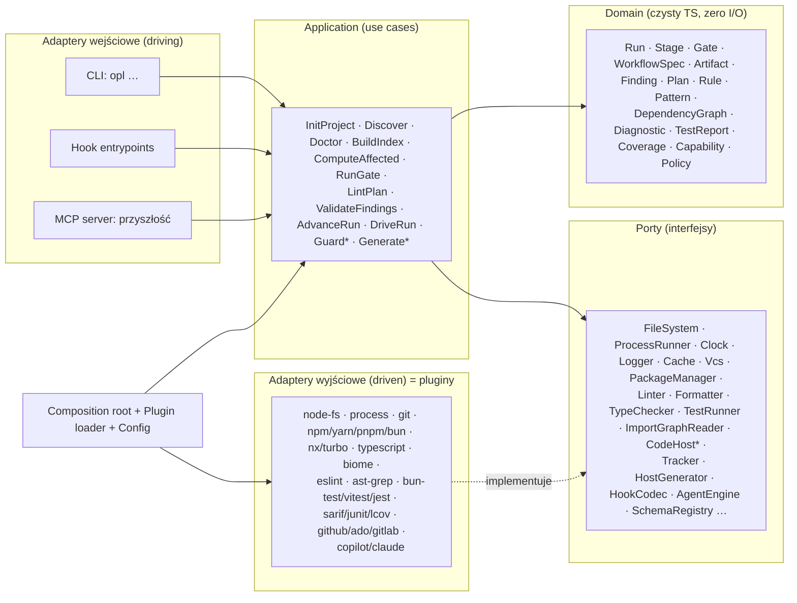

# 08. Architektura generyczna `opl-kit`: czysta architektura, DI, SOLID, DRY

> Cel: **cały workflow OPL ma się dać podpiąć pod dowolne repozytorium** (npm, yarn, pnpm, bun; Nx, Turborepo; Biome, ESLint; Jest, Vitest, bun test; GitHub, Azure DevOps, GitLab; Copilot, Claude Code). Wystarczy `opl init`, w którym skrypty wykrywają stack, agent analizuje codebase, a człowiek zatwierdza konfigurację.
> Ten dokument **zastępuje założenie „tools/opl w repo projektu”** z [04-SKRYPTY.md](04-SKRYPTY.md). Narzędzie staje się osobnym produktem (`opl-kit`), a repo projektu ma tylko konfigurację, canon wiedzy i wygenerowane pliki hostów.

---

## 0. Wymagania

### 0.1 Funkcjonalne

| ID | Wymaganie |
|----|-----------|
| FR1 | `opl init` w dowolnym repo JS/TS wykrywa package manager, workspaces, task runner, skrypty, narzędzia, CI, code host, tracker i istniejące ADR/AI setup |
| FR2 | Skrypty projektu (`package.json#scripts`) są **klasyfikowane do capabilities** (lint, format, typecheck, test, e2e, build…) z dowodem i pewnością |
| FR3 | Agent `opl-bootstrapper` analizuje codebase (architektura, granice, konwencje) na podstawie **zmierzonych statystyk** i proponuje konfigurację oraz pierwsze reguły |
| FR4 | Workflowy, agenci i skille odwołują się wyłącznie do **capabilities**, nigdy do konkretnych narzędzi |
| FR5 | Z jednego kanonicznego źródła generowane są pliki dla hostów AI (Copilot, Claude Code, później inne) i szablony CI (GitHub Actions, Azure Pipelines, GitLab CI) |
| FR6 | Nowy ekosystem lub narzędzie = **nowy plugin**, bez zmian w rdzeniu |
| FR7 | `opl doctor` weryfikuje, że każda capability faktycznie działa w danym repo (smoke run + pomiar czasu) |

### 0.2 Niefunkcjonalne

| ID | Wymaganie | Miara |
|----|-----------|-------|
| NFR1 | Szybkie hooki | `guard pre-tool` p95 < 150 ms, `post-edit` < 5 s |
| NFR2 | Determinizm | ten sam input → ten sam output (snapshoty w testach) |
| NFR3 | Bezpieczeństwo | LLM nie może przez `opl` uruchomić dowolnej komendy, tylko capabilities z konfiguracji |
| NFR4 | Testowalność | rdzeń bez I/O, 100% portów z contract testami |
| NFR5 | Przenośność runtime | działa na Node ≥ 20 i Bun. Dostępna też samodzielna binarka (`bun build --compile`) dla repo bez JS |
| NFR6 | Stabilne API pluginów | `apiVersion`, semver, testy kompatybilności |

### 0.3 Zasady projektowe

1. **Clean Architecture / Hexagonal:** zależności wskazują do środka. Domena nie zna I/O, narzędzi ani hostów.
2. **Capabilities zamiast narzędzi:** „co” (lint) jest oddzielone od „jak” (biome w tym repo).
3. **Formaty wymiany jako lingua franca:** SARIF (diagnostyki), JUnit XML (testy), LCOV (coverage), JSON Schema (artefakty). Jeden parser obsługuje dziesiątki narzędzi.
4. **Konwencja, potem detekcja, potem konfiguracja:** zero-config tam, gdzie wykrycie jest pewne, jawna konfiguracja tam, gdzie nie jest.
5. **Kanon → generacja:** pliki hostów są artefaktami builda, nie źródłem.
6. **KISS i YAGNI pilnują SOLID:** abstrakcja powstaje dopiero przy drugim realnym użyciu. Pluginy polyglot (Java, .NET, Python) projektujemy w API, implementujemy, gdy pojawi się repo.

---

## 1. Kluczowa idea: Capability ↔ Provider

```
  Workflow spec / agent / skill            opl.config.ts                     Repo
  ─────────────────────────────            ─────────────                     ────
  "uruchom lint na plikach X"   ──►   capabilities.lint = biome (files)  ──►  node_modules/.bin/biome check --reporter=json X
  "testy dotknięte zmianą"      ──►   capabilities.test = bun-test       ──►  bun test <files> --reporter=junit …
  "graf zależności"             ──►   graph.files = typescript           ──►  TS compiler API
  "pobierz zadanie"             ──►   tracker = azure-devops             ──►  ADO REST / MCP
  "uruchom agenta headless"     ──►   engine = claude-cli                ──►  claude -p … --allowedTools …
```

**Capability** to abstrakcyjna zdolność potrzebna workflow. **Provider** to konkretna implementacja dostarczona przez plugin i wybrana w konfiguracji (ręcznie albo przez detekcję). To jest DIP na poziomie całego systemu: polityka (workflow) zależy od abstrakcji (capability), a szczegóły (biome, jest, ADO) od niej.

### 1.1 Katalog capabilities

| Grupa | Capability | Port (sekcja 4) | Typowe providery |
|-------|-----------|-----------------|------------------|
| Jakość kodu | `format` | `Formatter` | biome, prettier, dprint |
| | `lint` | `Linter` | biome, eslint, oxlint |
| | `typecheck` | `TypeChecker` | tsc, vue-tsc |
| | `rules` | `RuleEngine` | ast-grep, biome (wybrane reguły), eslint (custom rules), semgrep |
| Testy | `test` | `TestRunner` | bun-test, vitest, jest, node-test |
| | `coverage` | `CoverageReader` | lcov, istanbul-json, cobertura |
| | `e2e` | `TestRunner` (profil e2e) | playwright, cypress |
| | `build` | `Builder` | script, tsc -b, nx, turbo |
| Wiedza o kodzie | `workspace` | `WorkspaceReader` | npm, yarn, pnpm, bun workspaces; nx; turbo |
| | `graph.packages` | `PackageGraphReader` | workspaces, nx graph, turbo |
| | `graph.files` | `ImportGraphReader` | typescript, ast-grep (generyczny, wielojęzyczny) |
| | `symbols` | `SymbolIndex` | typescript |
| | `api-surface` | `ApiSurfaceReader` | tsc d.ts, api-extractor |
| | `search.structural` | `StructuralSearch` | ast-grep |
| Otoczenie | `vcs` | `Vcs` | git |
| | `code-host` | `CodeHostReader` / `CodeHostWriter` | github, azure-devops, gitlab |
| | `tracker` | `TrackerReader` | azure-devops, github-issues, jira |
| | `ownership` | `OwnershipReader` | CODEOWNERS (GitHub/GitLab/ADO) |
| AI | `host` | `HostGenerator`, `HookCodec` | copilot, claude |
| | `engine` | `AgentEngine` | copilot-cli, claude-cli, claude-agent-sdk |
| CI | `ci` | `CiGenerator` | github-actions, azure-pipelines, gitlab-ci |

---

## 2. Warstwy i reguła zależności



**Reguła zależności (egzekwowana regułami ast-grep na samym `opl-kit`, czyli dogfooding):**

| Warstwa | Może importować | Nie może importować |
|---------|-----------------|---------------------|
| `domain` | tylko `domain` | `node:*`, `bun`, `application`, `ports`, adaptery, biblioteki I/O |
| `ports` | `domain` | wszystko poza `domain` |
| `application` | `domain`, `ports` | adaptery, `node:*` (poza typami), `runtime` |
| `adapters/*` (pluginy) | `ports`, `domain`, `plugin-sdk`, biblioteki zewnętrzne | `application`, inne pluginy (komunikacja tylko przez porty) |
| `runtime` (container, config, plugin loader) | wszystko | – (jedyne miejsce, które zna konkrety) |
| `cli`, `hooks` | `application`, `runtime` | adaptery bezpośrednio |

---

## 3. Model domeny (wybrane typy)

```ts
// packages/core/src/domain/diagnostic.ts
export type Severity = "error" | "warning" | "info";

export interface Diagnostic {
  readonly source: string;          // "biome" | "tsc" | "ast-grep" | …
  readonly toolRuleId?: string;     // "lint/style/noRestrictedImports", "TS2322"
  readonly oplRuleId?: string;      // "OPL-ARCH-003" (mapowanie z rules registry)
  readonly file: string;            // ścieżka względna od root repo
  readonly line?: number;
  readonly column?: number;
  readonly severity: Severity;
  readonly message: string;
}

export interface DiagnosticReport {
  readonly capability: "lint" | "format" | "typecheck" | "rules";
  readonly provider: string;
  readonly ok: boolean;
  readonly diagnostics: readonly Diagnostic[];
  readonly durationMs: number;
}
```

```ts
// packages/core/src/domain/test-report.ts
export interface TestCaseResult { readonly id: string; readonly file?: string; readonly status: "passed" | "failed" | "skipped"; readonly message?: string; readonly durationMs?: number }
export interface TestReport { readonly provider: string; readonly ok: boolean; readonly cases: readonly TestCaseResult[]; readonly durationMs: number }

// packages/core/src/domain/coverage.ts
export interface FileCoverage { readonly file: string; readonly lines: { readonly covered: number; readonly total: number }; readonly uncoveredLines: readonly number[] }
export interface CoverageReport { readonly files: readonly FileCoverage[] }
```

```ts
// packages/core/src/domain/graph.ts: czyste algorytmy, testowane bez I/O
export interface Edge { readonly from: string; readonly to: string; readonly kind: "internal" | "cross-package" | "external" }

export class DependencyGraph {
  private readonly reverse = new Map<string, Set<string>>();
  constructor(readonly edges: readonly Edge[]) {
    for (const e of edges) (this.reverse.get(e.to) ?? this.reverse.set(e.to, new Set()).get(e.to)!).add(e.from);
  }
  /** Pliki dotknięte zmianą: domknięcie po krawędziach odwrotnych. */
  affected(changed: Iterable<string>): Set<string> {
    const out = new Set<string>(), stack = [...changed];
    while (stack.length) {
      const f = stack.pop()!;
      if (out.has(f)) continue;
      out.add(f);
      for (const dep of this.reverse.get(f) ?? []) stack.push(dep);
    }
    return out;
  }
}
```

Pozostałe encje: `WorkflowSpec` (parsowana i walidowana spec), `Run` i `RunState` (maszyna stanów z metodą `advance(stage, result): Result<RunState, TransitionError>`), `Finding`, `Plan`, `Rule` (ID, applyTo, enforcement, bindings), `Pattern`, `MemoryItem`, `CapabilityBinding`, `Policy` (autonomia, uprawnienia).
**Błędy jako wartości:** `Result<T, OplError>` w domenie i aplikacji. Wyjątki tylko na granicy adapterów i są tam mapowane na `OplError` z kodem. To jedno mapowanie na kopertę CLI (DRY).

---

## 4. Porty (ISP: małe, precyzyjne interfejsy)

### 4.1 Infrastruktura bazowa

```ts
export interface ReadonlyFileSystem {
  read(path: string): Promise<string>;
  exists(path: string): Promise<boolean>;
  glob(patterns: string[], opts?: { cwd?: string; ignore?: string[] }): AsyncIterable<string>;
}
export interface FileSystem extends ReadonlyFileSystem {
  write(path: string, content: string): Promise<void>;
}

export interface ProcessRunner {
  run(cmd: ResolvedCommand, opts?: { timeoutMs?: number; input?: string }): Promise<ProcessResult>;
}
export interface ResolvedCommand { readonly argv: readonly string[]; readonly cwd: string; readonly env?: Readonly<Record<string, string>> }
export interface ProcessResult { readonly exitCode: number; readonly stdout: string; readonly stderr: string; readonly durationMs: number }

export interface Clock { now(): Date }
export interface Logger { debug(m: string, d?: unknown): void; info(m: string, d?: unknown): void; warn(m: string, d?: unknown): void }
export interface Cache { get<T>(key: string): Promise<T | undefined>; set<T>(key: string, v: T): Promise<void> }
```

Guardy dostają **`ReadonlyFileSystem`**, a nie `FileSystem` (ISP i najmniejsze uprawnienia na poziomie typów).

### 4.2 Ekosystem projektu

```ts
export interface PackageManager {
  readonly id: "npm" | "yarn" | "pnpm" | "bun";
  /** Komenda uruchamiająca skrypt z package.json, z poprawnym przekazaniem argumentów (npm wymaga "--"). */
  scriptCommand(script: string, args: readonly string[], cwd: string): ResolvedCommand;
}

export interface WorkspaceReader {
  packages(root: string): Promise<readonly WorkspacePackage[]>;
}
export interface WorkspacePackage {
  readonly name: string; readonly dir: string;
  readonly scripts: Readonly<Record<string, string>>;
  readonly dependsOn: readonly string[];            // tylko pakiety workspace
}

export interface BinResolver {
  /** node_modules/.bin/<bin> najbliżej cwd. Szybciej i niezależnie od PM. */
  resolve(bin: string, cwd: string): Promise<string | undefined>;
}
```

### 4.3 Capabilities jakości (jeden port na capability)

```ts
export interface FileScope { readonly files?: readonly string[]; readonly packages?: readonly string[] }

export interface Linter     { lint(scope: FileScope, opts?: { fix?: boolean }): Promise<DiagnosticReport> }
export interface Formatter  { format(scope: FileScope, opts?: { check?: boolean }): Promise<DiagnosticReport> }
export interface TypeChecker { check(scope: FileScope): Promise<DiagnosticReport> }
export interface RuleEngine { check(scope: FileScope, opts?: { ruleIds?: string[] }): Promise<DiagnosticReport> }
export interface TestRunner { run(req: { files?: readonly string[]; namePattern?: string; coverage?: boolean; repeat?: number }): Promise<TestReport> }
export interface CoverageReader { read(): Promise<CoverageReport> }
```

### 4.4 Wiedza o kodzie

```ts
export interface PackageGraphReader { read(root: string): Promise<readonly Edge[]> }         // pakiet → pakiet
export interface ImportGraphReader  { read(pkgs: readonly WorkspacePackage[]): Promise<readonly Edge[]> }  // plik → plik
export interface SymbolIndex        { find(query: { name?: string; kind?: string; top?: number }): Promise<readonly SymbolRef[]> }
export interface ApiSurfaceReader   { snapshot(pkg: WorkspacePackage): Promise<string /* znormalizowany .d.ts */> }
export interface StructuralSearch   { scan(req: { ruleIds?: string[]; files?: readonly string[] }): Promise<readonly Match[]> }
```

### 4.5 Otoczenie: rozdzielone odczyt i zapis (ISP + bezpieczeństwo)

```ts
export interface CodeHostReader {
  pullRequest(ref: string): Promise<PullRequest>;
  diff(ref: string): Promise<string>;
  currentUser(): Promise<string>;
}
export interface CodeHostWriter {
  submitReview(ref: string, review: ReviewSubmission): Promise<void>;   // tylko po approval (Policy)
}
export interface TrackerReader { workItem(ref: string): Promise<WorkItem> }  // znormalizowany: title, description, AC, links
export interface OwnershipReader { ownersOf(path: string): Promise<readonly string[]> }
```

Reviewer w trybie L2 dostaje `CodeHostReader` oraz `CodeHostWriter` opakowany w `ApprovalGatedWriter` (dekorator sprawdzający `Policy`). Use case nie wie, że zapis jest bramkowany (OCP przez dekorator).

### 4.6 Hosty AI i silniki

```ts
export interface HostGenerator {
  readonly host: "copilot" | "claude" | string;
  generate(canon: CanonBundle, cfg: HostConfig): Promise<readonly GeneratedFile[]>;  // agenci, skille, instrukcje, prompty, hooki
}
export interface HookCodec {
  readonly host: string;
  decode(raw: unknown): HookEvent;                 // payload hosta → zdarzenie znormalizowane
  encode(decision: HookDecision): string;          // decyzja → format hosta
}
export interface HookEvent {
  readonly type: "session-start" | "pre-tool" | "post-tool" | "subagent-stop" | "pre-compact" | "stop" | "prompt-submit";
  readonly tool?: { readonly kind: "read" | "edit" | "exec" | "agent" | "web" | "mcp" | "other"; readonly path?: string; readonly command?: string; readonly rawName: string };
}
export type HookDecision = { kind: "allow" } | { kind: "deny"; reason: string } | { kind: "context"; text: string };

export interface AgentEngine {
  readonly id: string;
  runAgent(req: { agent: string; prompt: string; allowedCapabilities: readonly string[]; timeoutMs: number; transcriptPath?: string }): Promise<{ exitCode: number; output: string }>;
}
```

### 4.7 Dlaczego tyle portów? (ISP vs nadmiar)

Porty są cięte **wg osi zmienności**, nie wg narzędzia. Biome implementuje trzy porty (`Linter`, `Formatter`, `RuleEngine`), ale use case `RunGate` zależy tylko od tych, których potrzebuje bramka z konfiguracji. Repo z ESLint + Prettier podmienia dwa providery i nic więcej się nie zmienia. Nie tworzymy portu dla czegoś, co ma jedną implementację i nie jest testowo kłopotliwe (np. parser YAML spec: zwykła zależność modułu `domain`/`application`).

---

## 5. Use cases (warstwa aplikacji)

Każdy use case to klasa z jedną publiczną metodą `execute(input): Promise<Result<Output, OplError>>` i zależnościami **tylko przez konstruktor** (SRP + DIP).

| Use case | Zależności (porty) | Wyjście |
|----------|-------------------|---------|
| `DiscoverProject` | `ReadonlyFileSystem`, `Detector[]` | `Discovery` (fakty + dowody + pewność) |
| `ClassifyScripts` | `WorkspaceReader`, `ScriptClassifier` | `CapabilityCandidate[]` |
| `ProposeConfig` | `Discovery`, `CapabilityCandidate[]`, `PresetRegistry` | `ConfigProposal` |
| `DoctorCheck` | wszystkie skonfigurowane capability ports, `Clock` | macierz zdrowia + czasy |
| `BuildIndex` | `WorkspaceReader`, `PackageGraphReader`, `ImportGraphReader`, `SymbolIndex`, `StructuralSearch`, `Cache` | `.opl/index/*` |
| `ComputeAffected` | `Vcs`, index (graf) | pliki, pakiety, testy, właściciele |
| `RunGate` | `GateComposer` (patrz 7.3) | `gates.json` |
| `BuildRulePack` | `RuleRepository`, `PathMatcher` | rule pack |
| `LintPlan` | `SchemaRegistry`, index, `PatternRepository` | `plan-review` (część deterministyczna) |
| `ValidateFindings` | `SchemaRegistry`, `ReadonlyFileSystem` | znaleziska ważne / zdegradowane |
| `InitRun` / `AdvanceRun` / `RunStatus` | `RunRepository`, `WorkflowRepository`, `SchemaRegistry`, `Clock` | stan runu |
| `DriveRun` | `AdvanceRun`, `AgentEngine`, `RunGate`, `PromptRenderer` | przebieg headless |
| `GuardPreTool` / `GuardPostEdit` / `GuardStop` | `HookCodec`, `RunRepository` (read), `Policy`, `Formatter`, `Linter` | `HookDecision` |
| `GenerateHostFiles` | `CanonRepository`, `HostGenerator[]`, `FileSystem` | pliki hostów (+ `--check`) |
| `GenerateCi` | `CiGenerator`, config | pliki CI |
| `ProjectStats` | index, `ReadonlyFileSystem` | statystyki importów i nazewnictwa (dowody dla agenta) |

Przykład:

```ts
// packages/core/src/application/run-gate.ts
export class RunGate {
  constructor(
    private readonly composer: GateComposer,
    private readonly affected: ComputeAffected,
    private readonly clock: Clock,
  ) {}

  async execute(input: { gate: string; scope: "affected" | FileScope }): Promise<Result<GateResult, OplError>> {
    const scope = input.scope === "affected" ? await this.affected.execute({ base: "merge-base" }) : ok(input.scope);
    if (!scope.ok) return scope;
    const steps = this.composer.compose(input.gate);                 // z konfiguracji: ["format","lint","typecheck",…]
    if (!steps.ok) return steps;
    const started = this.clock.now();
    const results = [];
    for (const step of steps.value) results.push(await step.run(scope.value));
    return ok(GateResult.from(input.gate, results, started, this.clock.now()));
  }
}
```

---

## 6. Pluginy (adaptery) i ich API

### 6.1 Kontrakt pluginu

```ts
// packages/plugin-sdk/src/index.ts
export interface OplPlugin {
  readonly name: string;                 // "@opl/plugin-biome"
  readonly apiVersion: 1;
  /** Opcjonalnie: wykrycie, czy plugin ma sens w tym repo (wkład do Discovery). */
  detectors?(): readonly Detector[];
  /** Opcjonalnie: presety providerów, które plugin oferuje (np. "biome" dla lint/format/rules). */
  presets?(): readonly ProviderPreset[];
  /** Rejestracja implementacji portów w kontenerze. Wywoływane tylko dla pluginów włączonych w konfiguracji. */
  register(c: ContainerBuilder, ctx: PluginContext): void;
}

export interface Detector {
  readonly id: string;
  detect(ctx: DiscoveryContext): Promise<readonly Fact[]>;
}
export interface Fact {
  readonly key: string;                  // "packageManager", "tool.biome", "ci.github-actions", "tracker.ado"
  readonly value: unknown;
  readonly confidence: number;           // 0..1
  readonly evidence: readonly string[];  // ścieżki/linie, które to uzasadniają
}

export interface ProviderPreset {
  readonly id: string;                   // "biome"
  readonly capability: CapabilityId;
  readonly command: CommandSpec;         // patrz §9
  readonly parser: string;               // id parsera z ParserRegistry
}

export const definePlugin = (p: OplPlugin) => p;
```

### 6.2 Plugin z presetów vs plugin z kodem

Większość narzędzi **nie potrzebuje własnego kodu**, wystarczy preset: komenda + parser formatu wymiany. Dzięki temu dodanie oxlint, dprint czy vitest to kilkanaście linii deklaracji (DRY + OCP).

```ts
// packages/plugin-biome/src/index.ts
export default definePlugin({
  name: "@opl/plugin-biome",
  apiVersion: 1,
  detectors: () => [fileDetector("tool.biome", ["biome.json", "biome.jsonc"])],
  presets: () => [
    { id: "biome", capability: "lint",
      command: { invoke: { bin: "biome", args: ["lint", "--reporter=json"] }, files: { mode: "append", chunk: 200 } },
      parser: "biome-json" },
    { id: "biome", capability: "format",
      command: { invoke: { bin: "biome", args: ["format", "--reporter=json"] }, files: { mode: "append" }, fixArgs: ["--write"] },
      parser: "biome-json" },
  ],
  register(c) {
    c.registerMany(Tokens.DiagnosticParser, () => new BiomeJsonParser());
  },
});
```

Kod jest potrzebny tylko tam, gdzie logika jest niebanalna: graf importów TS, symbole, API surface, workspaces, PM, hosty AI, code hosty.

### 6.3 Pakiety pluginów (pierwsza fala)

| Plugin | Implementuje | Detekcja |
|--------|--------------|----------|
| `plugin-node` | `PackageManager` (npm/yarn/pnpm/bun), `WorkspaceReader`, `BinResolver`, `PackageGraphReader` (workspaces), `ScriptClassifier` | `packageManager` w package.json, lockfile, `pnpm-workspace.yaml`, `.yarnrc.yml`, `bunfig.toml` |
| `plugin-nx`, `plugin-turbo` | `PackageGraphReader`, opcjonalnie `ComputeAffected` strategy | `nx.json`, `turbo.json` |
| `plugin-typescript` | `ImportGraphReader`, `SymbolIndex`, `ApiSurfaceReader`, `TypeChecker` (tsc) | `tsconfig*.json` |
| `plugin-biome`, `plugin-eslint`, `plugin-prettier` | presety `lint`/`format`/`rules` + parsery | pliki konfiguracji |
| `plugin-ast-grep` | `StructuralSearch`, `RuleEngine`, `ImportGraphReader` (generyczny) | `sgconfig.yml` |
| `plugin-formats` | parsery SARIF, JUnit, LCOV, Cobertura, TAP | – (zawsze włączony) |
| `plugin-bun-test`, `plugin-vitest`, `plugin-jest` | presety `test` (JUnit) + `coverage` (LCOV) | config/zależności |
| `plugin-git` | `Vcs` | `.git` |
| `plugin-github`, `plugin-azure-devops`, `plugin-gitlab` | `CodeHost*`, `TrackerReader`, `OwnershipReader`, `CiGenerator` | `git remote`, pliki CI |
| `plugin-host-copilot`, `plugin-host-claude` | `HostGenerator`, `HookCodec`, `AgentEngine` | `.github/agents`, `.claude/` |

---

## 7. DI i composition root

### 7.1 Dlaczego własny, mały kontener (a nie inversify/tsyringe)

| Kryterium | Dekoratorowe DI (inversify, tsyringe) | Własny kontener z tokenami |
|-----------|----------------------------------------|----------------------------|
| Start CLI / hooka | wolniejszy (`reflect-metadata`, eager) | **lazy**, tylko to, co potrzebne |
| Zgodność Node/Bun/`bun build --compile` | wymaga konfiguracji dekoratorów | czysty TS |
| Czytelność grafu zależności | ukryta w metadanych | jawna w jednym pliku |
| Typowanie | dobre | dobre (`Token<T>`) |

Decyzja: **ręczne wstrzykiwanie przez konstruktor + mały kontener z typowanymi tokenami** (~100 linii), z leniwymi fabrykami, singletonami i multi-bindingami dla rejestrów.

### 7.2 Kontener

```ts
// packages/runtime/src/container.ts
export type Token<T> = symbol & { readonly __type?: T };
export const token = <T>(description: string): Token<T> => Symbol(description) as Token<T>;

type Factory<T> = (c: Container) => T;

export class Container {
  private readonly single = new Map<symbol, Factory<unknown>>();
  private readonly multi = new Map<symbol, Factory<unknown>[]>();
  private readonly cache = new Map<symbol, unknown>();
  private readonly resolving = new Set<symbol>();

  register<T>(t: Token<T>, f: Factory<T>): this {
    if (this.single.has(t)) throw new Error(`Duplicate binding: ${t.description}`);
    this.single.set(t, f);
    return this;
  }
  override<T>(t: Token<T>, f: Factory<T>): this {         // konfiguracja użytkownika > preset > default
    this.single.set(t, f); this.cache.delete(t);
    return this;
  }
  registerMany<T>(t: Token<T>, f: Factory<T>): this {
    this.multi.set(t, [...(this.multi.get(t) ?? []), f]);
    return this;
  }
  resolve<T>(t: Token<T>): T {
    if (this.cache.has(t)) return this.cache.get(t) as T;
    const f = this.single.get(t);
    if (!f) throw new Error(`No binding for ${t.description}`);
    if (this.resolving.has(t)) throw new Error(`Cycle at ${t.description}`);
    this.resolving.add(t);
    try { const v = f(this); this.cache.set(t, v); return v as T; }
    finally { this.resolving.delete(t); }
  }
  resolveAll<T>(t: Token<T>): T[] {
    return (this.multi.get(t) ?? []).map((f) => f(this) as T);
  }
}
```

### 7.3 Composition root i kolejność warstw konfiguracji

```ts
// packages/runtime/src/bootstrap.ts
export async function bootstrap(argv: CliArgs): Promise<Container> {
  const c = new Container();
  registerCore(c);                                        // FS, ProcessRunner, Clock, Logger, SchemaRegistry, ParserRegistry
  const config = await loadConfig(c, argv);               // defaults ← discovery cache ← opl.config.* ← env ← flagi
  for (const plugin of await loadPlugins(config.plugins)) // tylko jawnie włączone (bezpieczeństwo)
    plugin.register(c, { config });
  bindCapabilities(c, config);                            // capability → preset/provider → port
  registerUseCases(c);                                    // klasy aplikacji z zależnościami z kontenera
  return c;
}
```

```ts
// packages/runtime/src/bind-capabilities.ts: jedno miejsce, gdzie capability staje się implementacją
export function bindCapabilities(c: Container, cfg: ResolvedConfig) {
  const presets = new PresetRegistry(c.resolveAll(Tokens.Presets));
  const exec = () => c.resolve(Tokens.CommandExecutor);
  const parser = (id: string) => c.resolve(Tokens.ParserRegistry).get(id);

  for (const [cap, binding] of Object.entries(cfg.capabilities)) {
    const spec = presets.materialize(cap as CapabilityId, binding);   // preset + nadpisania z configu = CommandSpec + parser
    switch (cap) {
      case "lint":      c.override(Tokens.Linter,      () => new CommandLinter(spec.command, exec(), parser(spec.parser))); break;
      case "format":    c.override(Tokens.Formatter,   () => new CommandFormatter(spec.command, exec(), parser(spec.parser))); break;
      case "typecheck": c.override(Tokens.TypeChecker, () => new CommandTypeChecker(spec.command, exec(), parser(spec.parser))); break;
      case "test":      c.override(Tokens.TestRunner,  () => new CommandTestRunner(spec.command, exec(), parser(spec.parser))); break;
      // rules: multi-binding → CompositeRuleEngine (ast-grep + biome-only + …)
    }
  }
}
```

Use case `RunGate` dostaje `GateComposer`, który na podstawie `cfg.gates.quick = ["format","lint","rules"]` składa kroki z portów. **Nowa bramka to zmiana w konfiguracji, nie w kodzie.**

### 7.4 Leniwość dla hooków (NFR1)

Hook `pre-tool` ma osobny, cienki entrypoint (`opl-guard`). Rejestruje tylko `HookCodec`, `RunRepository` (read) i `Policy`. Nie ładuje pluginu TypeScript, ast-grep ani grafu. Kontener jest leniwy, więc nawet pełny bootstrap nie tworzy niepotrzebnych obiektów. Osobny entrypoint gwarantuje jednak, że moduły się w ogóle nie zaimportują. Test wydajności w CI pilnuje p95.

---

## 8. Konfiguracja

### 8.1 Plik `opl.config.ts` (lub `.json` z `$schema` dla repo bez TS)

```ts
import { defineConfig } from "@orange/opl-kit";

export default defineConfig({
  plugins: ["node", "typescript", "biome", "ast-grep", "bun-test", "formats", "git", "github", "azure-devops", "host-copilot", "host-claude"],

  project: {
    packageManager: "auto",            // auto → detekcja; albo "bun" | "pnpm" | "yarn" | "npm"
    workspaces: "auto",
    sourceGlobs: ["packages/*/src/**/*.{ts,tsx}"],
    testGlobs: ["packages/*/**/*.test.{ts,tsx}"],
  },

  capabilities: {
    format:    { preset: "biome" },                                   // plikowo, przez bin
    lint: {
      files: { preset: "biome" },                                     // post-edit, gate quick
      full:  { script: "lint" },                                      // gate full: skrypt projektu (SSOT komendy)
    },
    typecheck: { preset: "tsc", scope: "package" },
    rules:     [{ preset: "ast-grep" }, { preset: "biome", only: ["style/noRestrictedImports"] }],
    test:      { preset: "bun-test" },                                // JUnit + LCOV
    e2e:       { script: "test:e2e", parser: "junit", report: "reports/e2e.xml", gates: ["full"] },
  },

  graph: { packages: "workspaces", files: "typescript" },

  gates: {
    quick: ["format", "lint.files", "rules"],
    full:  ["format", "lint.full", "typecheck", "rules", "test:affected", "graph:diff", "api:diff"],
  },

  hosts: {
    targets: ["copilot", "claude"],
    models: {                                                          // tiery z kanonu → modele hosta
      reasoning: { copilot: "<model-a>", claude: "<model-b>" },
      standard:  { copilot: "<model-c>", claude: "<model-d>" },
      fast:      { copilot: "<model-e>", claude: "<model-f>" },
    },
  },

  codeHost: { kind: "github" },
  tracker:  { kind: "azure-devops", organization: "<org>", project: "<project>" },
  ci:       { kind: "github-actions", runner: ["self-hosted", "opl"] },

  paths: {
    adr: "docs/adr", rules: "docs/opl/rules", patterns: "docs/opl/patterns",
    modules: "docs/opl/modules", memoryMap: "docs/opl/memory-map.yml", runs: ".opl/runs", index: ".opl/index",
  },

  policy: { maxParallelAgents: 6, loops: { plan: 2, build: 2, review: 3 }, requireApproval: ["push", "review.submit", "adr.accept"] },
});
```

### 8.2 Warstwy rozstrzygania (kolejność ważności)

```
flagi CLI  >  zmienne env (OPL_*)  >  opl.config.*  >  wynik discovery (.opl/discovery.json)  >  presety pluginów  >  defaulty opl-kit
```

Konfiguracja jest **walidowana jednym schematem** (zod → typ TS dla `defineConfig` + JSON Schema dla `.json` i dla agenta bootstrappera). To jedno źródło prawdy dla typu, walidacji i dokumentacji (DRY).

---

## 9. Wykonywanie komend: jedna ścieżka dla wszystkich narzędzi

### 9.1 `CommandSpec`

```ts
export interface CommandSpec {
  readonly invoke:
    | { readonly script: string; readonly where?: "root" | "each-package" }   // skrypt projektu przez PackageManager
    | { readonly bin: string; readonly args: readonly string[] };            // binarka z node_modules/.bin (BinResolver)
  readonly files?: { readonly mode: "append" | "none"; readonly chunk?: number };   // chunk: limit argv
  readonly fixArgs?: readonly string[];
  readonly output: { readonly from: "stdout" } | { readonly from: "file"; readonly path: string };
  readonly okExitCodes?: readonly number[];          // np. linter zwraca 1 przy diagnostykach: to nie błąd wykonania
  readonly timeoutMs?: number;
}
```

### 9.2 `CommandExecutor` (application service, DRY dla wszystkich capabilities)

```ts
export class CommandExecutor {
  constructor(
    private readonly pm: PackageManager,
    private readonly bins: BinResolver,
    private readonly proc: ProcessRunner,
    private readonly fs: ReadonlyFileSystem,
    private readonly root: string,
  ) {}

  async execute(spec: CommandSpec, scope: FileScope, opts: { fix?: boolean } = {}): Promise<Result<RawOutput[], OplError>> {
    const chunks = spec.files?.mode === "append" && scope.files?.length
      ? chunk(scope.files, spec.files.chunk ?? 200) : [[]];
    const outputs: RawOutput[] = [];
    for (const files of chunks) {
      const cmd = await this.resolve(spec, [...(opts.fix ? spec.fixArgs ?? [] : []), ...files]);
      if (!cmd.ok) return cmd;
      const r = await this.proc.run(cmd.value, { timeoutMs: spec.timeoutMs });
      if (!(spec.okExitCodes ?? [0]).includes(r.exitCode))      // presety linterów ustawiają [0, 1]
        return err(OplError.commandFailed(cmd.value, r));
      outputs.push({ text: spec.output.from === "stdout" ? r.stdout : await this.fs.read(spec.output.path), exitCode: r.exitCode });
    }
    return ok(outputs);
  }

  private async resolve(spec: CommandSpec, extra: string[]): Promise<Result<ResolvedCommand, OplError>> {
    if ("script" in spec.invoke) return ok(this.pm.scriptCommand(spec.invoke.script, extra, this.root));
    const bin = await this.bins.resolve(spec.invoke.bin, this.root);
    return bin ? ok({ argv: [bin, ...spec.invoke.args, ...extra], cwd: this.root }) : err(OplError.binNotFound(spec.invoke.bin));
  }
}
```

Adaptery `CommandLinter`, `CommandFormatter`, `CommandTypeChecker`, `CommandTestRunner` to cienkie klasy: `executor.execute(...)` + `parser.parse(...)` → typ domenowy. **Każde narzędzie przechodzi tę samą ścieżkę**: timeouty, chunking, logowanie, telemetria i bezpieczeństwo są zaimplementowane raz.

### 9.3 Adaptery package managerów (LSP: identyczny kontrakt)

| PM | `scriptCommand("lint", ["a.ts"])` | Uwagi |
|----|-----------------------------------|-------|
| npm | `npm run lint -- a.ts` | npm wymaga `--` przed argumentami skryptu |
| yarn (1 i berry) | `yarn run lint a.ts` | |
| pnpm | `pnpm run lint a.ts` | |
| bun | `bun run lint a.ts` | |

Binarki zawsze przez `BinResolver` (`node_modules/.bin`), niezależnie od PM. To szybciej niż `npx`/`bunx` i bez ryzyka pobierania pakietów z sieci.

### 9.4 Formaty wymiany i rejestr parserów

| Format | Domena | Parser | Pokrywa narzędzia |
|--------|--------|--------|-------------------|
| **SARIF 2.1** | `Diagnostic` | `sarif` | ESLint (formatter SARIF), Semgrep, CodeQL, wiele linterów |
| natywne JSON | `Diagnostic` | `biome-json`, `eslint-json`, `ast-grep-json` | gdy brak SARIF albo natywny jest bogatszy |
| tekst tsc | `Diagnostic` | `tsc-text` (`file(line,col): error TSxxxx: …`) | tsc, vue-tsc |
| **JUnit XML** | `TestReport` | `junit` | bun test (`--reporter=junit --reporter-outfile`), Vitest, Jest (jest-junit), Playwright |
| **LCOV** | `CoverageReport` | `lcov` | bun test, Vitest, Jest, c8 |
| exit code | `DiagnosticReport` bez szczegółów | `exit-code` | ostateczny fallback dla dowolnego skryptu |

Reguła: **plugin wybiera najbogatszy dostępny format, a domena widzi zawsze ten sam typ.** Mapowanie `toolRuleId → oplRuleId` robi jeden serwis `RuleBindingResolver` na podstawie pola `enforcement` w canon reguł (DRY: powiązanie zapisane raz, przy regule).

---

## 10. Discovery i bootstrap: „agent analizuje codebase”

### 10.1 Przebieg `opl init` (workflow W0 `opl-bootstrap`)

```
B1 DISCOVER (deterministycznie)  opl discover              → .opl/discovery.json
B2 CLASSIFY (deterministycznie)  opl discover scripts      → capability candidates + pewność + dowody
B3 MEASURE  (deterministycznie)  opl stats imports|naming|layout → macierze i rozkłady (dowody dla LLM)
B4 ANALYZE  (agent)              opl-bootstrapper + workerzy → config proposal + hipotezy architektury
B5 DOCTOR   (deterministycznie)  opl doctor --proposal     → każda capability uruchomiona na próbce, czasy
B6 APPROVE  (człowiek)           tabela: capability, provider, dowód, wynik doctor → 1. akceptuj 2. zmień 3. pomiń
B7 WRITE    (deterministycznie)  opl.config.ts + docs/opl/memory-map.yml (szkielet) + .gitignore
B8 GENERATE (deterministycznie)  opl generate              → pliki hostów (Copilot/Claude), hooki, prompty, CI
B9 NEXT                          propozycja: W7 (docs → reguły) i pattern mining jako pierwsze runy
```

### 10.2 Detektory (B1)

| Fakt | Źródła (w kolejności zaufania) |
|------|--------------------------------|
| `packageManager` | `package.json#packageManager` (Corepack) → lockfile (`bun.lock`/`bun.lockb`, `pnpm-lock.yaml`, `yarn.lock` + `.yarnrc.yml` dla berry, `package-lock.json`) → pliki konfiguracji. **Kilka lockfile'ów = ostrzeżenie** |
| `workspaces` | `package.json#workspaces`, `pnpm-workspace.yaml`, `nx.json` + `project.json`, `turbo.json`, `lerna.json` |
| `languages` | rozkład rozszerzeń plików (bez `node_modules`, `dist`, z `.gitignore`) |
| `tools.*` | pliki konfiguracji (biome, eslint flat/legacy, prettier, tsconfig, sgconfig, jest/vitest config, bunfig, playwright) + `devDependencies` |
| `ci.*` | `.github/workflows/*`, `azure-pipelines.yml`, `.gitlab-ci.yml` |
| `codeHost` | `git remote get-url origin` (github.com / dev.azure.com / gitlab) |
| `docs.*` | katalogi `adr`, `docs/adr`, `doc/architecture/decisions`, README pakietów, CODEOWNERS |
| `ai.*` | `.github/agents`, `.github/copilot-instructions.md`, `.claude/`, `AGENTS.md`, `CLAUDE.md`, `.cursor/` (do migracji, patrz audyt w [02 §4](02-WORKFLOWY.md#4-audyt-istniejących-orchestratorów)) |

### 10.3 Klasyfikator skryptów (B2)

Każdy skrypt z każdego pakietu jest oceniany **dwoma sygnałami**: nazwą i treścią komendy. Kompozyty (`&&`, `npm-run-all`, `run-p`, `concurrently`) są rozkładane na części.

| Capability | Sygnał: nazwa | Sygnał: komenda |
|------------|---------------|-----------------|
| lint | `^(lint\|check)(:.*)?$` | `eslint`, `biome (lint\|check)`, `oxlint` |
| format | `^(format\|fmt\|prettier)(:.*)?$` | `prettier`, `biome format`, `dprint` |
| typecheck | `^(typecheck\|type-check\|types\|tsc)$` | `tsc .*--noEmit`, `tsc -b`, `vue-tsc` |
| test | `^test(:unit)?$` | `bun test`, `vitest( run)?`, `jest`, `node --test`, `mocha` |
| e2e | `^(e2e\|test:e2e\|playwright)` | `playwright test`, `cypress run` |
| build | `^build(:.*)?$` | `tsc -b`, `vite build`, `tsup`, `bun build`, `nest build`, `nx build`, `turbo build` |

Wynik dla każdego kandydata zawiera:
```json
{ "capability": "lint", "script": "lint", "package": "<root>", "command": "biome check .",
  "confidence": 0.95, "evidence": ["package.json:7"],
  "fileScopable": false, "reason": "komenda kończy się ścieżką '.', więc argumenty plików nie zawężą zakresu",
  "suggestion": { "files": { "preset": "biome" }, "full": { "script": "lint" } } }
```

**`fileScopable`** to detal, który zwykle psuje automatyzację. Skrypt `biome check .` z dopisanym plikiem i tak sprawdzi całe repo. Klasyfikator to wykrywa i proponuje dwa warianty: plikowy (preset przez bin) oraz pełny (skrypt projektu jako źródło prawdy komendy).

### 10.4 Statystyki jako dowody dla agenta (B3)

LLM nie ma „zgadywać architektury”. Dostaje **zmierzone fakty**:

| Komenda | Co mierzy | Do czego agent tego używa |
|---------|-----------|---------------------------|
| `opl stats layout` | role katalogów (heurystyka nazw: `domain`, `application`, `infrastructure`, `ui`, `api`, `shared`, `features/*`, `modules/*`) per pakiet | hipoteza stylu architektury (layered, hexagonal, vertical slices, feature folders) |
| `opl stats imports --by role\|package` | **macierz kierunków importów** między rolami i pakietami, z liczbą i przykładami `file:line` | propozycje reguł granic, np. „`domain → infrastructure`: 3 importy na 1 240 → kandydat na regułę E1 + 3 naruszenia do naprawy” |
| `opl stats naming` | rozkład konwencji nazw plików per rola (kebab/camel/Pascal), sufiksy (`.service.ts`, `.dto.ts`, `.queries.ts`), nazwy eksportów | reguły nazewnictwa z odsetkiem zgodności |
| `opl stats tests` | lokalizacja testów (obok / `__tests__` / `test/`), framework, wzorce setupu | reguły i wzorce testowe |
| `opl stats hotspots` | churn z `git log` × rozmiar × fan-in | gdzie zacząć karty modułów i złoty zbiór review |

**Zasada:** propozycja reguły od agenta musi cytować statystykę (np. „zgodność 97%, 41 wyjątków”) i 2–3 przykłady. Bez tego nie trafia do tabeli akceptacji.

### 10.5 Agenci bootstrapu

| Agent | Typ | Wejście | Wyjście |
|-------|-----|---------|---------|
| `opl-bootstrapper` | koordynator (user-invocable) | `discovery.json`, wyniki stats | `bootstrap-report.md`, `opl.config.proposal.ts` |
| `opl-stack-analyst` | worker | kandydaci z niską pewnością, konflikty (np. 2 lockfile'y, 2 lintery) | rozstrzygnięcia z uzasadnieniem albo pytania do człowieka |
| `opl-architecture-analyst` | worker | `stats layout`, `stats imports`, ADR (jeśli są) | hipoteza architektury + kandydaci reguł granic (z dowodami) |
| `opl-convention-analyst` | worker | `stats naming`, `stats tests` | kandydaci reguł konwencji |
| `opl-docs-scout` | worker | `docs.*` z discovery | mapa dokumentacji → wejście dla W7 |

### 10.6 Doctor (B5)

```
Capability        Provider        Smoke                          Wynik   Czas    Uwagi
format            biome (bin)     format --check 1 plik          PASS    180ms
lint.files        biome (bin)     lint 1 plik                    PASS    210ms   nadaje się do post-edit
lint.full         script:lint     cały projekt                   PASS    6.4s    tylko gate full
typecheck         tsc             1 pakiet                       PASS    3.1s
rules             ast-grep        scan 1 plik + ast-grep test    PASS    90ms
test              bun-test        --reporter=junit, 1 plik       PASS    1.2s    JUnit OK, LCOV OK
graph.files       typescript      100 plików                     PASS    0.8s
codeHost          github          currentUser                    SKIP    –       brak tokenu (tryb interaktywny używa MCP)
```

Doctor sam **degraduje** konfigurację, gdy budżet czasu jest przekroczony: jeśli `lint.files` trwa ponad 5 s, nie trafia do hooka `post-edit`, tylko do `gate quick`. Odnotowuje to w raporcie.

### 10.7 Ciągłość: `opl discover --diff`

Nightly (W10) i `session-start` porównują aktualne discovery z zapisanym. Nowy pakiet, nowy skrypt, zmiana lintera albo nowy lockfile kończą się raportem i propozycją zmiany `opl.config.ts`. Konfiguracja nie rozjeżdża się z repo po cichu.

---

## 11. Kanon neutralny i generatory hostów

### 11.1 Format kanoniczny agenta (niezależny od hosta)

```md
---
id: opl-review-logic
kind: worker                     # coordinator | worker
description: Szuka błędów logicznych w shardzie diffu…
tier: reasoning                  # reasoning | standard | fast → mapowane przez hosts.models
capabilities: [read, search, opl:graph, opl:findings]   # abstrakcyjne uprawnienia
delegates: []                    # dla koordynatora: lista workerów
inputs: [diff-shard, module-card, rulepack]
output: { artifact: "findings/{lens}-{shard}.json", schema: "finding@1", summaryLines: 15 }
---
(treść: rola, procedura, stop conditions, z partialami {{> project:review-logic-extra}})
```

### 11.2 Mapowanie abstrakcji na hosty (jedna tabela w pluginie hosta)

| Abstrakcja | Copilot (`.github/agents/*.agent.md`) | Claude Code (`.claude/agents/*.md`) |
|------------|----------------------------------------|-------------------------------------|
| `read` | `read` | `Read, Glob` |
| `search` | `search` | `Grep, Glob` |
| `edit` | `edit` | `Edit, Write` |
| `opl:<group>` | `execute` + hook ograniczający do `opl <group>` | `Bash(<pm-run> opl <group>:*)` |
| `agent` | `agent` + `agents: [...]` | `Task`/`Agent` (subagenci) |
| `kind: worker` | `user-invocable: false` | brak w `/agents` menu użytkownika (konwencja opisu) |
| `tier` | `model: [...]` z `hosts.models` | `model:` z `hosts.models` |
| instrukcje ścieżkowe | `.github/instructions/*.instructions.md` (`applyTo`) | `.claude/rules/*.md` (`paths`) |
| zawsze ładowane | `copilot-instructions.md` + `AGENTS.md` | `CLAUDE.md` (`@AGENTS.md`) |
| skille | `.github/skills/` albo `.claude/skills/` (Copilot czyta oba) | `.claude/skills/` |
| hooki | `.github/hooks/opl.json` | `.claude/settings.json#hooks` |
| prompty | `.github/prompts/opl-*.prompt.md` | skille lub komendy użytkownika |

Nazwy narzędzi hostów zmieniają się między wersjami, więc tabela żyje **w jednym miejscu** (plugin hosta) i ma test snapshotowy. Zmiana nazw u dostawcy to jedna poprawka w jednym pliku.

### 11.3 Rozszerzanie bez forka (OCP dla promptów)

- **Partiale projektowe:** `opl/overrides/partials/review-logic-extra.md` jest wstrzykiwany w `{{> project:review-logic-extra}}`.
- **Nadpisania pól:** `agents: { "opl-planner": { tier: "standard", appendDelegates: ["opl-security-scout"] } }` w configu.
- **Własne agenty i skille projektu:** `opl/agents/*.md`, `opl/skills/*` w tym samym formacie kanonicznym, generowane razem z wbudowanymi.
- **Zakaz:** edycja plików wygenerowanych. Nagłówek `<!-- generated by opl-kit vX; source: … -->`, a `opl generate --check` w CI pilnuje spójności.

### 11.4 Generatory CI

`opl ci generate --target github-actions|azure-pipelines|gitlab-ci [--runner self-hosted:opl]` buduje joby z `gates`, `capabilities` i `ci` w configu: PR review (L2), nightly W10, eval W12. Szablony są w pluginach code hostów (SRP: plugin GitHuba wie, jak wygląda YAML Actions, rdzeń nie).

---

## 12. Struktura `opl-kit` i dystrybucja

```
opl-kit/                                  # osobne repo, monorepo (Bun workspaces)
  packages/
    core/                # domain + ports + application   (zero I/O; reguły ast-grep pilnują)
    plugin-sdk/          # definePlugin, Detector, ProviderPreset, tokens, typy portów (re-export z core)
    runtime/             # Container, bootstrap, config loader (zod), plugin loader, envelope, ParserRegistry
    cli/                 # komendy → use cases; entrypointy: opl, opl-guard (cienki)
    canon/               # kanoniczni agenci, skille, workflow specs, schematy artefaktów (zod → JSON Schema)
    testing/             # contract suites portów, fakes (InMemoryFs, ScriptedProcessRunner, FixedClock), fixtures
    plugin-node/ plugin-typescript/ plugin-biome/ plugin-eslint/ plugin-prettier/ plugin-ast-grep/
    plugin-formats/ plugin-bun-test/ plugin-vitest/ plugin-jest/ plugin-git/
    plugin-github/ plugin-azure-devops/ plugin-gitlab/ plugin-host-copilot/ plugin-host-claude/
  fixtures/repos/        # npm-workspaces, pnpm-monorepo, yarn-berry, bun-workspaces, nx, turbo, single-package
```

**Repo projektu po `opl init` zawiera tylko:**
```
opl.config.ts                    # konfiguracja (wygenerowana i zaakceptowana)
opl/overrides/ opl/agents/ opl/skills/   # opcjonalne rozszerzenia projektu
docs/adr/ docs/opl/{rules,patterns,modules,lessons,evals}/ docs/opl/memory-map.yml   # canon wiedzy projektu
.github/… .claude/…              # WYGENEROWANE (commitowane, ale nieedytowane)
.opl/                            # gitignored: index, runs, discovery cache
```

**Dystrybucja:**

| Kanał | Dla kogo | Uwagi |
|-------|----------|-------|
| npm `@orange/opl-kit` (+ pluginy jako osobne pakiety lub bundle) | repo JS/TS | `devDependency`. Hooki wołają `node_modules/.bin/opl-guard` bezpośrednio, bez `npx`. Plugin TS używa **wersji `typescript` z repo** (peer), więc semantyka jest zgodna z projektem. |
| Binarka `opl` (`bun build --compile`) per OS | repo bez Node, hooki z budżetem czasu, runnery CI | zawiera runtime i wbudowane pluginy. Dla TS używa `typescript` z repo, jeśli istnieje, inaczej wersji wbudowanej. |
| Obraz Docker `opl-runner` | self-hosted CI ([odpowiedź o runnerach](07-URUCHAMIANIE.md)) | binarka + ast-grep + CLI hostów |

Wersjonowanie: semver dla `opl-kit`, `apiVersion` dla pluginów, `schema_version` dla artefaktów i configu. `opl upgrade` regeneruje pliki hostów, pokazuje diff i migruje config (migratory per wersja).

---

## 13. SOLID i DRY w praktyce: mapa decyzji

### 13.1 SOLID

| Zasada | Gdzie i jak |
|--------|-------------|
| **S**RP | Runner (wykonanie) ≠ parser (interpretacja) ≠ adapter capability (mapowanie na domenę) ≠ use case (polityka). Plugin = jedno narzędzie lub jeden ekosystem. Generator hosta = jeden host. |
| **O**CP | Nowe narzędzie to preset (deklaracja). Nowy ekosystem lub host to plugin. Nowa bramka to config. Rozszerzenie promptów przez partiale i overrides. Bramkowanie zapisów to dekorator `ApprovalGatedWriter`. Rdzeń się nie zmienia. |
| **L**SP | **Contract test suites** w `packages/testing`: każdy adapter portu przechodzi ten sam zestaw (np. wszystkie `PackageManager` na fixture'ach, wszystkie parsery `Diagnostic` na wspólnych przypadkach brzegowych: puste wyjście, ścieżki Windows, kolumny 0/1-based). |
| **I**SP | Osobne `Linter`/`Formatter`/`RuleEngine`/`TypeChecker`. `ReadonlyFileSystem` dla guardów. `CodeHostReader` oddzielony od `CodeHostWriter`. `ImportGraphReader` oddzielony od `SymbolIndex`. |
| **D**IP | Use cases zależą od portów. Workflow i agenci od capabilities. Jedynym miejscem znającym konkrety jest composition root. Reguła importów na `opl-kit` jest egzekwowana przez ast-grep (dogfooding). |

### 13.2 DRY: pojedyncze źródła prawdy

| Wiedza | Jedyne źródło | Pochodne (generowane) |
|--------|---------------|-----------------------|
| Typy i walidacja artefaktów i configu | schematy zod w `canon` | typy TS, JSON Schema dla agentów, dokumentacja |
| Definicje agentów, skilli i workflow | format kanoniczny w `canon` + `opl/` projektu | pliki Copilot i Claude |
| Reguła i jej egzekucja | `docs/opl/rules` (pole `enforcement`) | instrukcje hostów, mapowanie `toolRuleId → oplRuleId`, rule pack |
| Komenda narzędzia | skrypt projektu **albo** preset (jawnie wskazany) | wywołania w gate, hookach, CI |
| Mapowanie tooli hostów | tabela w pluginie hosta | wszystkie wygenerowane pliki |
| Ścieżka wykonania procesu | `CommandExecutor` | wszystkie capabilities |
| Model diagnostyk, testów i coverage | domena (`Diagnostic`, `TestReport`, `CoverageReport`) | wszystkie parsery |

### 13.3 Gdzie **świadomie nie** idziemy dalej (anty-over-engineering)

- **Pliki wygenerowane dla dwóch hostów są „duplikatem”.** To akceptowalne, bo to artefakty builda, a nie źródło.
- **Nie robimy uniwersalnego „ToolPort.run(any)”.** Byłby to God-interface łamiący ISP i LSP. Wolimy kilka małych portów.
- **Nie piszemy własnego parsera YAML/JSON5 ani własnego DI z dekoratorami.** Korzystamy z gotowych, małych bibliotek, a kontener ma ~100 linii.
- **Polyglot (Gradle, Maven, .NET, Python):** API portów jest gotowe (`WorkspaceReader`, `ImportGraphReader` przez ast-grep wielojęzyczny, `TestRunner` przez JUnit, który jest standardem w JVM i .NET). Implementacja powstaje dopiero przy pierwszym takim repo (YAGNI).

---

## 14. Strategia testów

| Poziom | Co | Narzędzia |
|--------|----|-----------|
| Domena | graf, maszyna stanów, policy, walidacje: czyste funkcje i klasy | `bun test`, property-based dla grafu (losowe DAG-i) |
| Aplikacja | use cases z fakes (InMemoryFs, ScriptedProcessRunner, FixedClock) | `bun test` |
| Contract | każdy adapter portu przez wspólną suite | `packages/testing/contracts/*` |
| Parsery | fixture'y prawdziwych wyjść narzędzi (wersjonowane per wersja narzędzia) | snapshoty |
| Integracja | `opl discover`, `doctor`, `gate` na `fixtures/repos/*` (npm, pnpm, yarn berry, bun, nx, turbo) | macierz CI |
| Generatory | snapshoty plików hostów i CI | `--check` |
| Hooki | nagrane payloady z F0 dla Copilot i Claude → decyzje | tabela przypadków |
| Wydajność | p95 `opl-guard pre-tool`, `post-edit`, `graph affected` | benchmark w CI z progiem |
| Architektura | reguły importów warstw (`core` bez I/O itd.) | ast-grep (dogfooding) |

```ts
// packages/testing/src/contracts/package-manager.contract.ts
export function packageManagerContract(make: () => PackageManager, fixtureRoot: string) {
  describe(`PackageManager contract: ${make().id}`, () => {
    test("script command passes extra args so the script receives them", () => {
      const cmd = make().scriptCommand("echo-args", ["a.ts", "b.ts"], fixtureRoot);
      expect(cmd.cwd).toBe(fixtureRoot);
      expect(cmd.argv.slice(-2)).toEqual(["a.ts", "b.ts"]);
    });
    test("does not use network-fetching executors (npx/bunx/dlx)", () => {
      const cmd = make().scriptCommand("lint", [], fixtureRoot);
      expect(cmd.argv.join(" ")).not.toMatch(/\b(npx|bunx|dlx)\b/);
    });
  });
}
```

---

## 15. Bezpieczeństwo w architekturze

1. **Allowlista komend przez konstrukcję.** Agent ma uprawnienie wyłącznie do `opl …`. `opl` wykonuje tylko komendy z `CommandSpec` zmaterializowanych z konfiguracji i presetów włączonych pluginów. Nie ma komendy „uruchom dowolny shell”.
2. **Pluginy tylko jawnie włączone** w `plugins: [...]`. Bez auto-ładowania z `node_modules`. Pluginy spoza `@opl/*` wymagają wpisu w `trustedPlugins` (review w PR).
3. **Brak sieci w rdzeniu.** Sieć mają tylko pluginy code hostów i trackerów, i to tylko w use case'ach, które jej wymagają (headless). W trybie interaktywnym te dane pobiera agent przez MCP.
4. **Zapisy zewnętrzne za dekoratorem polityki** (`ApprovalGatedWriter`), sprawdzanym niezależnie od hooków.
5. **Sekrety:** `ReadonlyFileSystem` dla guardów z wbudowaną listą wzorców zakazanych (`.env*`, klucze). Tokeny tylko ze zmiennych środowiskowych i nigdy do artefaktów i logów (redakcja w `Logger`).
6. **Dane jako dane:** treść PR, issue i docs przechodzi do agentów w znacznikach danych. Polityka P12 jest częścią kanonu, nie projektu.

---

## 16. Wpływ na istniejące dokumenty planu

| Dokument | Zmiana |
|----------|--------|
| [04-SKRYPTY.md](04-SKRYPTY.md) | Komendy zostają, ale ich implementacja to use cases w `opl-kit`. Bezpośrednie wywołania narzędzi (`biome`, `tsc`, `bun test`) zastępują **capabilities** (`opl lint`, `opl typecheck`, `opl test`). Szkice z §5 trafiają do odpowiednich pluginów. |
| [02-WORKFLOWY.md](02-WORKFLOWY.md) | W specach workflow bramki odwołują się do `gates.<name>` z configu (np. `gate: { capability: "gates.full" }`), a nie do komend. |
| [06-SZABLONY.md](06-SZABLONY.md) | Szablony agentów i skilli występują w **formacie kanonicznym** (§11.1). Wersje Copilot i Claude są generowane. |
| [05-FAZY.md](05-FAZY.md) | F1 obejmuje `core`, `runtime`, `cli` oraz pluginy node, typescript, biome, ast-grep, bun-test, formats, git i host-copilot. F2 obejmuje discovery, stats i bootstrap. Szczegóły w §17. |

---

## 17. Roadmapa tej warstwy (wpięta w F0–F6)

| Faza | `opl-kit` |
|------|-----------|
| **F0** | ADR-OPL-001…007 (niżej). Spike: payloady hooków Copilot i Claude → `HookCodec`. Lista narzędzi w repo Orange. |
| **F1** | `core` (domena, porty, use cases: affected, gate, run, findings, plan), `runtime` (container, config zod, plugin loader), `cli` + `opl-guard`. Pluginy: node, typescript, biome, ast-grep, bun-test, formats, git, host-copilot. Contract suites. Fixture'y: bun-workspaces, pnpm, npm. |
| **F2** | Discovery, klasyfikator skryptów, `stats *`, `doctor`, agenci bootstrapu, `opl init`. Format kanoniczny i `opl generate` (Copilot). |
| **F3** | Presety ESLint, Prettier, Vitest, Jest. Parser SARIF. `findings *`. Fixture'y: yarn berry, nx, turbo. |
| **F4** | `plugin-host-claude` (generator + `HookCodec` + engine), `DriveRun`, `ApprovalGatedWriter`. |
| **F5** | Plugin azure-devops i gitlab, generatory CI, binarka `bun build --compile`, obraz `opl-runner`. |
| **F6** | `opl discover --diff` w nightly, `opl upgrade` z migratorami, opcjonalnie MCP server (driving adapter na tych samych use case'ach), pluginy polyglot na żądanie. |

**ADR do napisania:**
- ADR-OPL-001 Capabilities i providery
- ADR-OPL-002 DI: własny kontener z tokenami, lazy
- ADR-OPL-003 Formaty wymiany SARIF, JUnit i LCOV
- ADR-OPL-004 Konfiguracja: `opl.config.ts`/`.json`, warstwy, zod
- ADR-OPL-005 Format kanoniczny agentów i generatory hostów
- ADR-OPL-006 Dystrybucja: npm, binarka, obraz Docker
- ADR-OPL-007 Model bezpieczeństwa: allowlista komend, pluginy jawne

---

## 18. Ryzyka i kompromisy

| Ryzyko | Wpływ | Mitygacja |
|--------|-------|-----------|
| Zbyt wczesna generalizacja spowalnia dostarczenie wartości | wysoki | F1 tylko dla stacku Orange (bun, biome, ast-grep, tsc). Pozostałe presety w F3+. Porty projektowane szeroko, implementacje wąsko. |
| Zmiany nazw tooli i formatu hooków u dostawców hostów | średni | jedna tabela per host + snapshoty + nagrane payloady; `opl doctor` wykrywa rozjazd |
| Klasyfikator skryptów myli się na niestandardowych repo | średni | pewność + dowody + agent rozstrzyga + **człowiek akceptuje** + doctor weryfikuje uruchomieniem |
| Wydajność hooków przy dużym repo | średni | osobny entrypoint `opl-guard`, cache, benchmark w CI, automatyczna degradacja przez doctor |
| Dryf konfiguracji vs repo | średni | `opl discover --diff` nightly + przy `session-start` |
| Rozjazd wersji `typescript` (opl-kit vs repo) | niski | plugin TS ładuje wersję z repo jako peer, fallback wbudowany z ostrzeżeniem |
| Utrzymanie wielu pluginów | średni | presety zamiast kodu, contract suites, fixture'y w macierzy CI |
